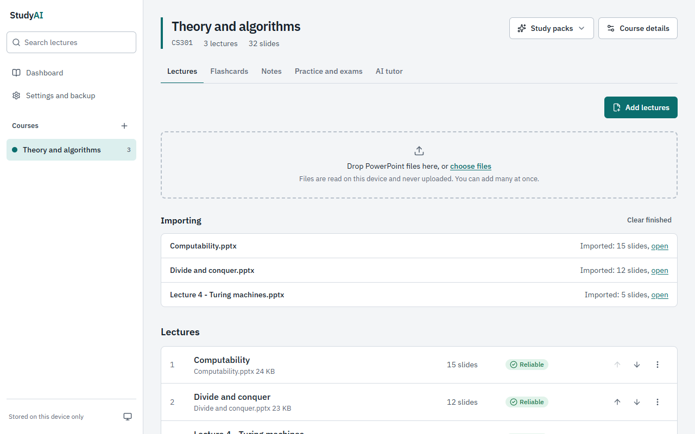
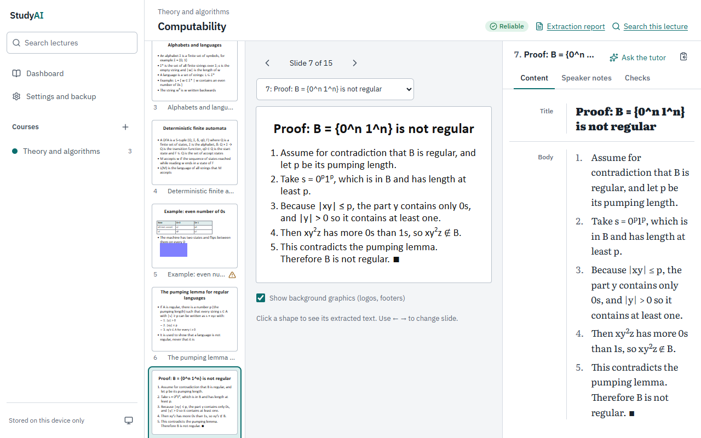
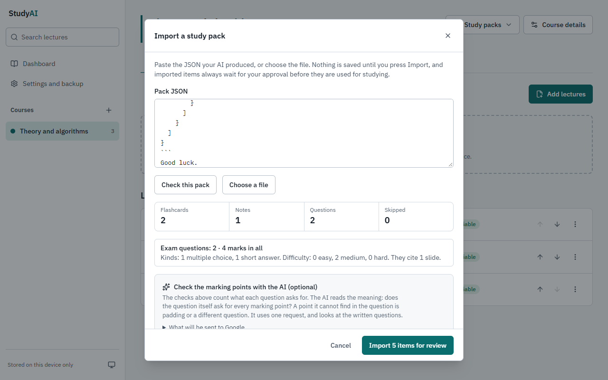
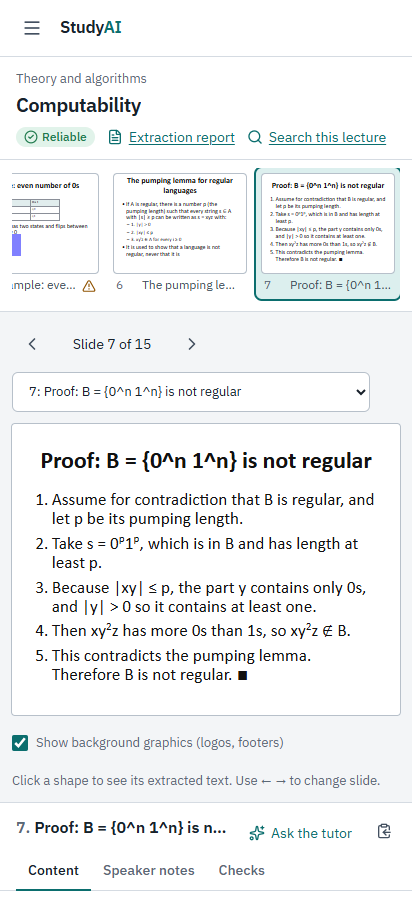

# StudyAI

[](https://github.com/zuhairhalawa/studyai/actions/workflows/ci.yml) [](https://github.com/zuhairhalawa/studyai/actions/workflows/codeql.yml)

A local-first study platform for university lectures. Drop in your PowerPoint files, read them slide by slide beside the text the app extracted, search everything, study with spaced-repetition flashcards and practice exams, and, only if you choose, ask an AI tutor that answers from your own slides and says which slide each point comes from.

Your lectures and study data stay in your browser. The study app needs no account and makes no third-party requests. The AI tutor is an optional add-on that you run yourself on Cloudflare's free plan with your own Google Gemini free-tier key; nothing is sent anywhere until you have confirmed what will be sent.



## What it does

* **Reads PowerPoint files faithfully.** Text, tables, charts, SmartArt, speaker notes, and equations (converted to LaTeX and drawn with KaTeX). Pictures whose words cannot be extracted are flagged, and you can type their words in. An extraction report says what was and was not understood.
* **Lets you check it against the original.** The slide is drawn beside the extracted text, with search across all lectures.
* **Studies with you.** Flashcards with FSRS spaced repetition, notes, practice exams with marking points, progress, and a backup ZIP of everything.
* **Understands what kind of lecture it is.** A lecture with proofs, machines, formulas, pseudocode or attack scenarios gets questions of that kind (a proof, the run of a machine, a calculation), not generic ones. The exam plan follows your professor's stated style ("mostly scenarios, short answers, proofs where they fit").
* **Checks AI output instead of trusting it.** Every quote a model cites is looked up on the real slide; every exam question is checked on the device for padded marks, marking points nobody asked for, a "scenario" that only restates the slide, and a model answer that would not earn full marks. Nothing is used until you approve it.
* **Says what the slides do not say.** The tutor is told about headings with no content, pictures it cannot read, formulas with undefined symbols, questions a slide asks without answering, and diagrams whose meaning sits in their layout. Anything beyond the slides is labelled "Beyond the slides".
* **Can write study packs with your Claude Code subscription** (the `lecture-pack` skill and command-line tool in this repository), or from any AI chat, with no API at all.



| Importing a study pack: every cited quote is checked | The same app on a phone |
|---|---|
|  |  |

The screenshots show invented lectures from `tests/fixtures/`; no real course material is in this repository.

## Quick start (no AI, no account)

Requirements: Node 22 or newer and pnpm 11.

```bash
git clone https://github.com/zuhairhalawa/studyai.git
cd studyai
pnpm install        # exact, pinned versions
pnpm dev            # http://localhost:5173
```

Create a course, drop in a `.pptx` file, and open it. The AI screens say "AI is not available here" until you set up the optional server below.

## Optional: the AI tutor on the Gemini free tier

The AI features run in a small Cloudflare Worker that **you** run, with **your** keys. This repository contains no key, no hostname and no access to anyone's deployment.

1. In [Google AI Studio](https://aistudio.google.com/) create an API key in a project that shows **Free tier** and **No billing account**. Do not add billing: the app is designed to run at $0, and it refuses to turn AI on until you have confirmed this.
2. Create your local secrets (they go in a git-ignored `.dev.vars` file, never in the repository):

   ```bash
   pnpm owner:keygen --write-dev-vars   # prints your owner key ONCE and writes the server secrets
   ```

   Then put your Gemini key in `.dev.vars` as `GEMINI_API_KEY=` (see [.dev.vars.example](.dev.vars.example)).
3. Run everything locally and open it:

   ```bash
   pnpm worker:dev                      # builds the app and serves it with the Worker at http://localhost:8787
   ```

4. Open **Settings → AI tutor**, sign in with the owner key, and follow the checklist: confirm the free-tier facts, approve the first request, turn AI on.

A fail-closed budget guard sits between the app and the model: daily and monthly spend caps, a request cap, and a stop whenever the billing state is unclear. Free-tier content may be used by Google to improve its products, so send only material you are comfortable sharing. How the guard works: [docs/FINANCIAL-SAFETY.md](docs/FINANCIAL-SAFETY.md).

To put your own copy online (also free), see [docs/DEPLOY.md](docs/DEPLOY.md). A deployed copy is private by default: every page and endpoint answers only a sign-in page until the owner signs in.

## Security and privacy

* **Local first.** Lectures, notes, flashcards, exams and progress live in IndexedDB on your device. A test enforces that the study app makes no third-party requests; the Content-Security-Policy allows connections to the app's own origin only.
* **Your keys, your deployment.** Nothing in this repository lets anyone use someone else's deployment. The AI endpoints need the owner's key (256-bit, signed cookies, CSRF and host checks, login lockout), and a deployment answers only the hosts its own owner configured. A clone has to be given its own keys.
* **Untrusted input is treated as untrusted.** PowerPoint files, study packs and model output are validated (size, ZIP-bomb and XML-entity limits, escaped prompts, strict JSON, quote checks) and wait for your approval.
* **Secrets** exist only as Cloudflare secrets or in `.dev.vars`. `pnpm scan:secrets` checks the working tree and the whole git history.

Report vulnerabilities privately: see [SECURITY.md](SECURITY.md).

## Development

```bash
pnpm check                  # types, Worker types, unit tests and browser tests, in order (needs Chrome)
pnpm test                   # unit and integration tests only
pnpm scan:secrets           # secret scan: working tree and full history
pnpm build                  # production build
pnpm notices                # regenerate THIRD-PARTY-NOTICES.md
```

The browser tests run the real local Worker and Durable Object with a scripted fake Gemini: no network, no account, no real AI request. If your system reserves their ports, set `STUDYAI_E2E_PORT_BASE` (see [CONTRIBUTING.md](CONTRIBUTING.md)). `STUDYAI_SCREENSHOTS=1 pnpm exec playwright test screenshots --project=desktop` regenerates the screenshots above from synthetic lectures.

| Path | What |
|---|---|
| `src/core/pptx/` | The PowerPoint engine: safe ZIP/XML, text, tables, charts, SmartArt, equations, notes, report |
| `src/core/study/` | Study packs and quote verification, flashcards, exams, the exam planner and the question checks |
| `src/core/tutor/` | What the browser may ask the AI, server-side prompts, strict parsers, slide context, teaching gaps |
| `src/core/ai/`, `worker/` | The budget guard and the Cloudflare Worker with its Durable Object |
| `src/ui/`, `src/pages/` | The React interface |
| `src/cli/`, `.claude/skills/lecture-pack/` | The command-line tool and the Claude Code skill |
| `tests/` | Unit, integration and browser tests, with a PowerPoint fixture builder (all lectures invented) |
| `docs/` | Architecture, decisions, financial safety, deployment |

## Contributing

Contributions are welcome; please read [CONTRIBUTING.md](CONTRIBUTING.md) first. In short: a defect gets a test that fails without the fix, a new rule gets a test for what it finds and for what it must leave alone, and no lecture slides, study packs, keys or personal data belong in an issue or a pull request.

## License

[MIT](LICENSE). The open-source packages the app ships are listed with their licenses in [THIRD-PARTY-NOTICES.md](THIRD-PARTY-NOTICES.md). Course material belongs to its authors and is not part of this project; use only lectures you have the right to study. StudyAI is not affiliated with Google, Microsoft, Cloudflare or Anthropic. Parts of the code were written with Claude's help.
